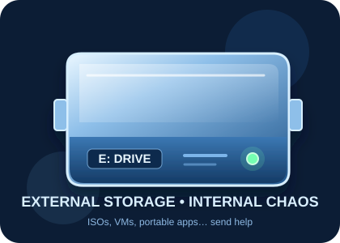
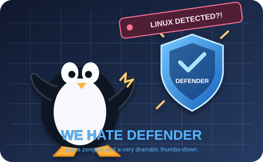
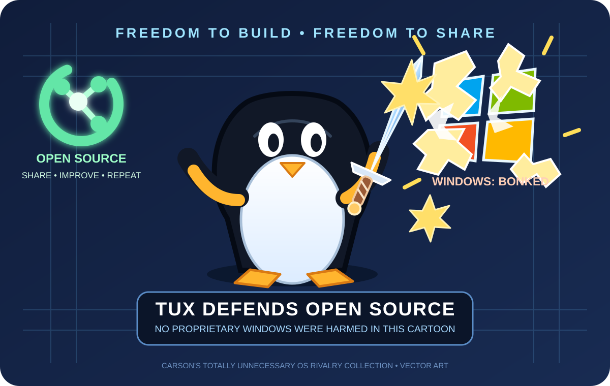
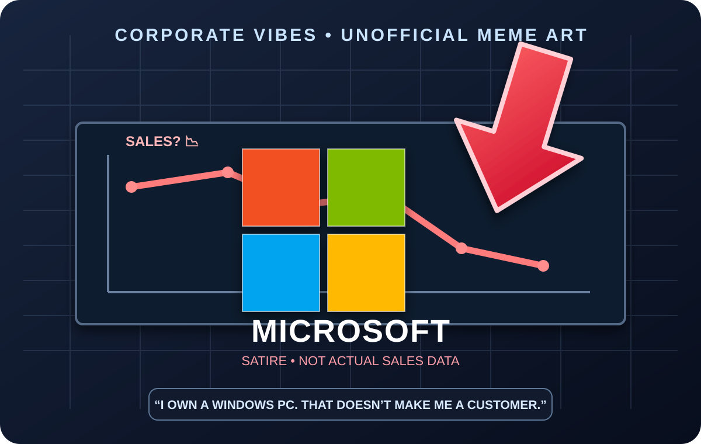
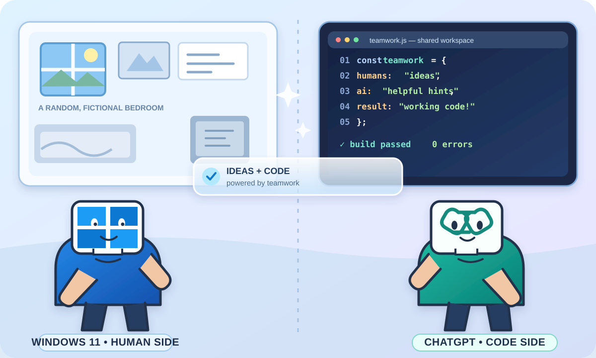
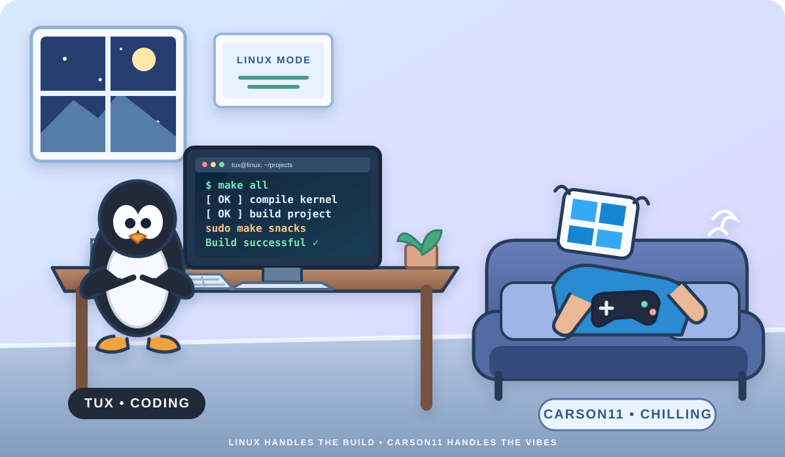

<script src="https://keepandroidopen.org/banner.js"></script>
<div align="center">


# 🪟💠 Welcome to Carson's Profile 💠🤖
#

<p><strong>⚠️ If you scroll down, prepare for chaos-</strong></p>

<a href="https://fonts.google.com/icons?selected=Material+Symbols+Outlined:account_child" title="Account Child"></a>&nbsp;&nbsp;<a href="https://github.com/" title="Shared Folder"></a>&nbsp;&nbsp;<a href="https://puppylinux-woof-ce.github.io/" title="Puppy Linux"></a>&nbsp;&nbsp;<a href="https://www.linux.org/" title="Linux Dark"></a>&nbsp;&nbsp;<a href="https://github.com/topics/programming" title="Programming"></a>&nbsp;&nbsp;<a href="https://developer.mozilla.org/" title="Programming Browser"></a>&nbsp;&nbsp;<a href="https://github.com/topics/software-development" title="Programming Hold Code"></a>&nbsp;&nbsp;<a href="https://www.freecodecamp.org/" title="Computer Programming"></a>&nbsp;&nbsp;<a href="https://www.cisa.gov/" title="Report Hacked"></a>&nbsp;&nbsp;<a href="https://github.com/topics/server" title="Server Path"></a>&nbsp;&nbsp;<a href="https://github.com/" title="Path Arrow"></a>&nbsp;&nbsp;<a href="https://github.com/topics/developer-tools" title="Pathfinder Work"></a>&nbsp;&nbsp;

<a href="https://www.kernel.org/" title="Linux"></a>
&nbsp;&nbsp;
<a href="https://www.kernel.org/" title="Linux"></a>
&nbsp;&nbsp;
<a href="https://www.linux.org/" title="Linux icon"></a>
&nbsp;&nbsp;
<a href="https://opensource.org/" title="Open Eye"></a>
&nbsp;&nbsp;
<a href="https://opensource.org/" title="Open Source"></a>
&nbsp;&nbsp;
<a href="https://www.kali.org/" title="Hacker"></a>
&nbsp;&nbsp;
<a href="https://www.kali.org/" title="Hacker icon"></a>
&nbsp;&nbsp;
<a href="https://www.android.com/" title="Android"></a>
&nbsp;&nbsp;
<a href="https://github.com/carjam120443-netizen" title="GitHub"></a>
&nbsp;&nbsp;
<a href="https://opensource.org/" title="Open Source Initiative">

</a>
&nbsp;&nbsp;
<a href="https://www.freebsd.org/" title="FreeBSD">

</a>
&nbsp;&nbsp;
<a href="https://www.openbsd.org/" title="OpenBSD">

</a>
&nbsp;&nbsp;
<a href="https://www.unix.org/" title="Unix">

</a>
&nbsp;&nbsp;
<a href="https://archive.org/" title="MS-DOS"></a>
&nbsp;&nbsp;
<a href="https://archive.org/" title="Internet Archive"></a>
&nbsp;&nbsp;
<a href="https://apps.gnome.org/Console/" title="GNOME Terminal"></a>
&nbsp;&nbsp;
<a href="https://chatgpt.com/" title="OpenAI ChatGPT"></a>
&nbsp;&nbsp;
<a href="https://www.microsoft.com/windows" title="Microsoft Windows"></a>
&nbsp;&nbsp;
<a href="https://www.microsoft.com/windows" title="Windows logo thin"></a>
&nbsp;&nbsp;
<a href="https://www.microsoft.com/windows" title="Windows Windows"></a>
&nbsp;&nbsp;
<a href="https://gitforwindows.org/" title="Git for Windows"></a>
&nbsp;&nbsp;
<a href="https://github.com/features/copilot" title="GitHub Copilot"></a>
&nbsp;&nbsp;
<a href="https://www.android.com/" title="Android"></a>
&nbsp;&nbsp;
<a href="https://www.virtualbox.org/" title="VirtualBox"></a>
&nbsp;&nbsp;
<a href="https://github.com/carjam120443-netizen/custom-win-packages" title="Terminal"></a>
&nbsp;&nbsp;
<a href="https://gitlab.com/" title="GitLab"></a>
&nbsp;&nbsp;
<a href="https://code.visualstudio.com/" title="Visual Studio Code"></a>
&nbsp;&nbsp;
<a href="https://docs.github.com/en/code-security/code-scanning" title="Code scanning"></a>
&nbsp;&nbsp;
<a href="https://shizuku.rikka.app/" title="Shizuku"></a>
&nbsp;&nbsp;
<a href="https://github.com/topjohnwu/Magisk" title="Magisk"></a>
&nbsp;&nbsp;
<a href="https://github.com/topics/superuser" title="SU"></a>
&nbsp;&nbsp;
<a href="https://www.android.com/" title="Android smartphone down"></a>
&nbsp;&nbsp;
<a href="https://www.mozilla.org/firefox/" title="Firefox"></a>
&nbsp;&nbsp;
<a href="https://www.gitkraken.com/" title="GitKraken"></a>
&nbsp;&nbsp;
<a href="https://github.com/search" title="Search"></a>
&nbsp;&nbsp;
<a href="https://github.com/" title="Code File"></a>
&nbsp;&nbsp;
<a href="https://www.mozilla.org/firefox/" title="Firefox Browser Internet Web"></a>
&nbsp;&nbsp;
<a href="https://www.kernel.org/" title="Linux"></a>
&nbsp;&nbsp;
<a href="https://www.debian.org/" title="Debian logo on a closed folder"></a>
&nbsp;&nbsp;
<a href="https://www.gnu.org/software/bash/" title="Bash Command"></a>
&nbsp;&nbsp;
<a href="https://github.com/carjam120443-netizen/carjam120443-netizen/blob/main/assets/tux-smashes-windows.svg" title="Tux smashing the Windows logo with a hammer"></a>
&nbsp;&nbsp;
<a href="https://github.com/carjam120443-netizen/carjam120443-netizen/blob/main/assets/e-drive.svg" title="External E drive"></a>
&nbsp;&nbsp;
<a href="https://github.com/carjam120443-netizen/carjam120443-netizen/blob/main/assets/we-hate-defender.svg" title="We Hate Defender Linux penguin illustration"></a>
&nbsp;&nbsp;
<a href="https://github.com/carjam120443-netizen/carjam120443-netizen/blob/main/assets/tux-defends-open-source.svg" title="Tux with a sword defending open source while a Windows logo shatters in a cartoon"></a>
&nbsp;&nbsp;
<a href="https://github.com/carjam120443-netizen/carjam120443-netizen/blob/main/assets/microsoft-sales-arrow.svg" title="Satirical Microsoft logo with a red downward arrow and falling chart; not actual sales data"></a>
&nbsp;&nbsp;
<a href="https://github.com/carjam120443-netizen/carjam120443-netizen/blob/main/assets/open-source-open-minds.svg" title="Linux penguin beneath the words Open Source, Open Minds"></a>
&nbsp;&nbsp;


<div align="center">

### 💠🪟 Aero Quick Launch

| 💎 **Profile & Projects** | 🐧 **Open Systems** | 🛠️ **Developer Tools** | 🤖 **Android Lab** |
|:---:|:---:|:---:|:---:|
| [GitHub Profile](https://github.com/carjam120443-netizen) · [carsonOS](https://github.com/carjam120443-netizen/carsonOS) | [Linux](https://www.kernel.org/) · [Debian](https://www.debian.org/) · [FreeBSD](https://www.freebsd.org/) | [Custom Win Packages](https://github.com/carjam120443-netizen/custom-win-packages) · [VS Code](https://code.visualstudio.com/) | [Keep Android Open](https://keepandroidopen.org/) · [Shizuku](https://shizuku.rikka.app/) |

### 🎵💠 Social & Creative Links

| 🎧 **Spotify** | 🎵 **TikTok** | 📺 **YouTube** | 🎶 **Suno** | 📚 **Internet Archive** |
|:---:|:---:|:---:|:---:|:---:|
| [Carson / Modestsongs401](https://open.spotify.com/artist/7w3eotYjg6CCodYjxNIpTI?si=p0bXMEPBSy2IUdxUd-us_A) | [@carson58700](https://www.tiktok.com/@carson58700?lang=en) | [@spongebobhijacks](https://www.youtube.com/@spongebobhijacks) | [@modestsongs401](https://suno.com/@modestsongs401) | [@carson_poole643](https://archive.org/details/@carson_poole643) |

</div>

---

# ✨ Linux • Android • Windows • VMs • Coding • OS Development ✨

`╭────────────────────────────────────────────────────────╮`

**💎 A little Aero glass • a little Android • a lot of tinkering 💎**

`╰────────────────────────────────────────────────────────╯`

> 🧑‍💻 **Current mode:** building weird stuff, fixing broken stuff, and seeing what happens. 🔧💀

**🛠️ Toolbox:** Linux · Android · Git/GitHub · VirtualBox · QEMU · PowerShell · ADB · Shizuku · ISO builders

</div>

---

## 🖥️💠 ASCII / System Showcase

<div align="center">

### 🐧 Linux / Tux

```text
          _nnnn_
        dGGGGMMb
       @p~qp~~qMb
       M|@||@) M|
       @,----.JM|
      JS^\\__/  qKL
     dZP        qKRb
    dZP          qKKb
   fZP            SMMb
   HZM            MMMM
   FqM            MMMM
 __| ".        |\\dS"qML
 |    `.       | `' \\Zq
_)      \\.___.,|     .'
\\____   )MMMMMP|   .'
     `-'       `--' hjm
```

### 🔨🐧 Tux vs. Windows — for absolutely no reason

<div align="center">


*Linux: “I have a very constructive suggestion for your window.”* 💀

### 🤝🪟🤖 Carson + ChatGPT — Coding Buddies

<div align="center">



*Carson: “It compiles!”*  
*ChatGPT, floating over the desk: “Nice. Now let's figure out why the tests are yelling.”* 💻✨

</div>

### 🐧💻 Tux Codes, Carson11 Chills

<div align="center">


</div>

Use the reusable code icon in Markdown or HTML with:

```html

```

<div align="center">



*Tux: “The build is compiling.”*  
*Carson11: “Awesome. I will continue contributing absolutely nothing from this couch.”* 😎🐧

*Linux handles the build. Carson11 handles the vibes.*

</div>

### 💾 E: Drive — external storage under pressure

<div align="center">


*“I STORE THE ISOs. I STORE THE VMs. WHY IS THERE ANOTHER LINUX DISTRO?!* 😭💽

### 🛡️🐧 We Hate Defender

<div align="center">


*Defender: “LINUX DETECTED?!”*  
*Carson: “bro it's a virtual machine 💀”*

</div>

### ⚔️🐧 Tux Defends Open Source — Windows Logo Bonked

<div align="center">


*Open source: share it, improve it, remix it. Windows: “WHY IS THERE A PENGUIN WITH A SWORD?!”* 💀🐧

</div>

### 📉🪟 Microsoft and the Red Arrow of Doom

<div align="center">


*“I own a Windows PC. That doesn’t make me a customer.”* 😭💀

</div>

### 🐧💚 Open Source, Open Minds

<div align="center">


*Learn • Share • Build Together* 🔓💻

</div>

### 🖥️ android / Fastfetch Art

```text
        -o          o-
          +hydNNNNdyh+
        +mMMMMMMMMMMMMm+
      `dMMm:NMMMMMMN:mMMd`
      hMMMMMMMMMMMMMMMMMMh
  ..  yyyyyyyyyyyyyyyyyyyy  ..
.mMMm`MMMMMMMMMMMMMMMMMMMM`mMMm.
:MMMM-MMMMMMMMMMMMMMMMMMMM-MMMM:
:MMMM-MMMMMMMMMMMMMMMMMMMM-MMMM:
:MMMM-MMMMMMMMMMMMMMMMMMMM-MMMM:
:MMMM-MMMMMMMMMMMMMMMMMMMM-MMMM:
-MMMM-MMMMMMMMMMMMMMMMMMMM-MMMM-
 +yy+ MMMMMMMMMMMMMMMMMMMM +yy+
      mMMMMMMMMMMMMMMMMMMm
      `/++MMMMh++hMMMM++/`
          MMMMo  oMMMM
          MMMMo  oMMMM
          oNMm-  -mMNs
```

### 🖥️ windows / ASCII

```text
 ,.=:!!t3Z3z.,
       :tt:::tt333EE3
       Et:::ztt33EEEL
      ;tt:::tt333EE7
     :Et:::zt333EEQ.
     it::::tt333EEF
    ;3=*^```"*4EEV
    ,.=::::!t=., `
   ;::::::::zt33)
  :t::::::::tt33.:Z3z..  `` ,..g.
  i::::::::zt33F
 ;:::::::::t33V
 E::::::::zt33L
{3=*^```"*4E3)
             ` :EEEEtttt::::z7
                 "VEzjt:;;z>*`
```

### 🌐 Keep Android Open

I'm also interested in keeping Android open and user-friendly. Check out **[Keep Android Open](https://keepandroidopen.org/)** for more on the movement around openness, interoperability, and user choice in the Android ecosystem. 🤖💚🔓

<table>
<tr>
<td>

### 💚 Android

`●` Customization  
`●` ADB  
`●` Shizuku  
`●` Android-x86  
`●` Open Android & user choice

</td>
<td>

### 💠 Aero

`●` Glass panels  
`●` Glossy borders  
`●` Blue gradients  
`●` Classic desktop vibes

</td>
</tr>
</table>

## 🍴🐙 Forking & Remixing

I like **forking repositories** and experimenting with them, especially when I want to learn how something works, customize it, or build my own version. 🔧💻

**Credit where credit is due:** I keep the original authors, project credits, and applicable licenses intact, and I make it clear when something is based on a fork. 🙌📜

> 🍴 **Fork it → 🔧 Modify it → 🧪 Experiment with it → 📝 Give credit**

## 🐧🖥️ Linux & OS Projects

> ╭──────────────────────────────────────────────╮  
> │ 🐧 **Linux** — building & customizing distros │  
> │ 🔧 **RebuiltTux** — custom Linux projects    │  
> │ 📦 **ISO Building** — Debian/Ubuntu/NixOS/Gentoo │  
> │ 🖥️ **Virtual Machines** — OS experimentation  │  
> │ 💾 **Boot & Installer Work** — ISO internals  │  
> ╰──────────────────────────────────────────────╯

## 🗂️🪦 From the Old Account

Some of the projects I worked on under **`carjam1200-jpg`** included:

- 🐧 `rebuilttux-os` — RebuiltTux OS development
- 🐧 `rebuilttux2` — another RebuiltTux development project
- 🤖 `Android-vms-app` — Android VM experimentation
- 🤖 `Android-vms-app1` — Android VM experimentation
- 🧪 `Android-vms-test` — Android/VM testing
- 🧪 `Android-vms-testy` — experimental VM work
- 💿 `Isovm` — ISO and VM experimentation
- 🧪 `Testrepo` — development/testing
- 🧪 `test-repo1` — development/testing

> 🪦 The old account is gone, but those projects and experiments are still part of the history behind this account.

## 🧰 Other & Recovered Projects

| 💠 Project | 📝 What it is |
|---|---|
| 🐧 **RebuiltTux ISO** | Custom Linux ISO development and live-system experiments |
| 🤖 **RebuiltDroid Tux** | Android-x86 based rebuild and boot/ISO experimentation |
| 🐧 **Rebuilt Unix** | Custom Unix/Linux experimentation |
| 🐧 **Rebuilt LFS** | Linux From Scratch experimentation |
| 🐧 **Rebuilt Ubuntu** | Ubuntu-based RebuiltTux experiments |
| ❄️ **Rebuilt NixOS** | NixOS ISO/build experimentation |
| 🔨 **Rebuilt Gentoo** | Gentoo ISO and package-management experimentation |
| 🍎 **macOS ISO Builder** | ISO-building experimentation |
| 🎮 **Roblox Custom CLI** | Custom command-line launcher/tooling experiments |
| 📱 **Android + Shizuku Tools** | Android customization and tooling |
| 🌐 **WebSim ChatGPT Server** | Experimental web/AI server project |
| 📦 **cpkg** | Custom package-manager experimentation |
| 🔐 **PrivLink** | Privacy/networking experimentation |

## 🪦💀 Retired & Archived Projects

A small graveyard for older experiments, abandoned forks, and projects I've decided not to maintain anymore. They're staying public as a record of the experiments, even if development has stopped. 🤣🗃️

| 🪦 Project | 📝 Status / what happened |
|---|---|
| [**CarsonKali**](https://github.com/carjam120443-netizen/CarsonKali) | Retired older OS experiment; newer OS work moved toward [carsonOS](https://github.com/carjam120443-netizen/carsonOS). |
| [**carsondeb**](https://github.com/carjam120443-netizen/carsondeb) | Retired Debian-based OS experiment; kept around as an archive while carsonOS is the newer direction. |
| [**macos-iso-builder**](https://github.com/carjam120443-netizen/macos-iso-builder) | Fork I considered working on, went back to Linux, and then forgot about. 💀 |
| [**websim-chatgpt-server**](https://github.com/carjam120443-netizen/websim-chatgpt-server) | Experimental WebSim/ChatGPT server project; no longer maintained and may be incomplete or nonfunctional. |
| [**win_iso_build_fork**](https://github.com/carjam120443-netizen/win_iso_build_fork) | Windows ISO-builder fork I never really continued; preserved with credit to the upstream project. |
| [**Test-OS**](https://github.com/carjam120443-netizen/Test-OS) | Older OS experiment, now retired and preserved for its history and files. |
| [**test-os2**](https://github.com/carjam120443-netizen/test-os2) | Retired OS experiment; no planned features, updates, or fixes. |
| [**FreeBSD-Termux**](https://github.com/carjam120443-netizen/FreeBSD-Termux) | Retired FreeBSD-on-Termux experiment; setup may be incomplete and expects a compatible ARM64 disk image. |
| [**forks-os-forks**](https://github.com/carjam120443-netizen/forks-os-forks) | Retired list project; I'm not planning to add more OS entries or maintain the lists. |
| [**chatgpt-archive.org**](https://github.com/carjam120443-netizen/chatgpt-archive.org) | ChatGPT ↔ Internet Archive connector experiment that never reached a working state, so I stopped trying to develop it. |
| [**MagiskOnWSALocal**](https://github.com/carjam120443-netizen/MagiskOnWSALocal) | My fork is retired; I didn't really do anything with it beyond forking it, so it remains as an archive. |

> ⚰️ **These repositories are not being actively maintained.** They may contain outdated code, unfinished ideas, or things that no longer work. I'm leaving them public as a digital archaeological record of my experiments. 🧑‍🔬💀

## 🧪🔧 Things I Like Experimenting With

- 🖥️ VirtualBox, QEMU and virtual machines
- 🐧 Linux distributions and custom ISO builds
- 📦 Package managers and alternative Linux systems
- 🤖 Android-x86 and Android customization
- 🔧 ADB, Shizuku and Android tooling
- 🔓 Open Android, interoperability and user choice
- 🍴 Forking, remixing and customizing open-source projects
- 🪟 Windows customization and Aero-era aesthetics
- 🐙 Git, GitHub Actions and automated builds
- 💻 CLI tools, shells and custom utilities
- 🧩 Bootloaders, initramfs, squashfs and ISO internals
- 🤖 AI and experimental web projects

## 🤖🧑‍💻 Code Helper

> Built with help from **ChatGPT** — debugging, coding, ideas, documentation, and occasional explanations of why something exploded. 🤖🔧

## ⚡💎 Currently

<div align="center">

`╭────────────────────────────────────────────────────────╮`

### 🪟✨ Building • Breaking • Fixing • Learning ✨🤖

**🐧 Linux  •  🤖 Android  •  🖥️ VMs  •  💻 Coding  •  🐙 GitHub  •  💠 Aero**

`╰────────────────────────────────────────────────────────╯`

</div>

---

<div align="center">

### 💠🪟 Thanks for visiting! 🤖💚

**Linux • Android • Windows • VMs • Coding • OS Development**

</div>
